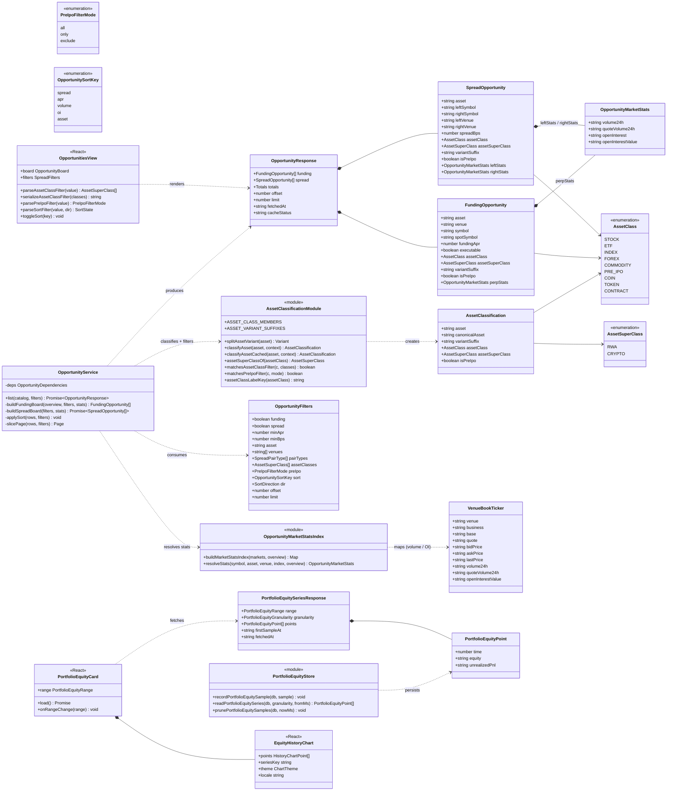
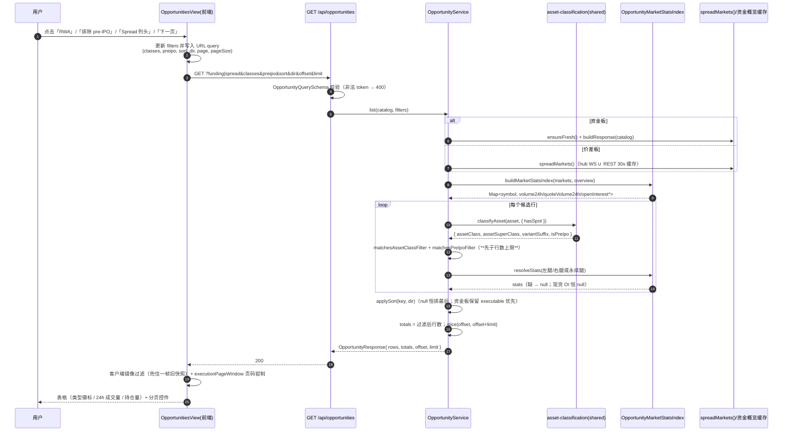
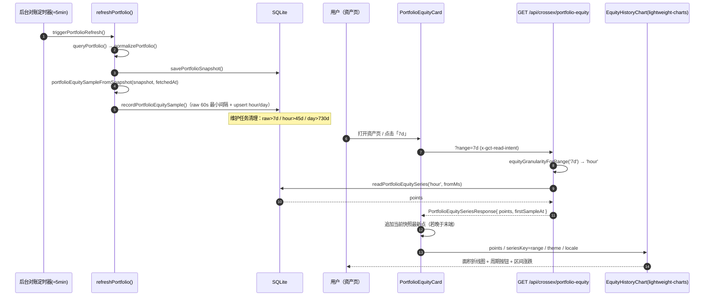
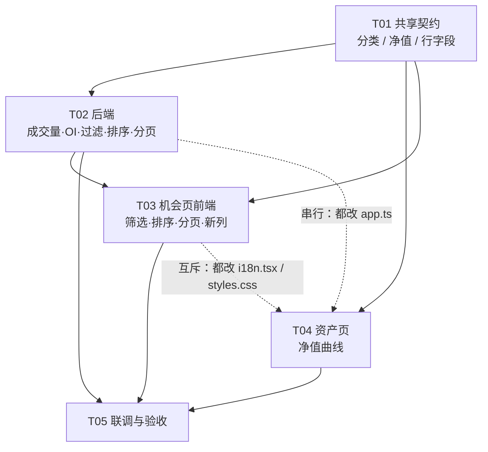

# Gate.io CrossEx 终端 —— 增量需求架构设计（资产分类 / 筛选 / 排序 / 分页 / 成交量持仓量 / 资产净值曲线）

- 仓库：`gate-crossex`（TS monorepo：`apps/backend` Fastify + better-sqlite3 + zod、`apps/frontend` React + Vite、`packages/{domain,public-data,shared-types}`）
- 基线提交：`423356d`（本次只做设计，不改源码；实现阶段所有改动留在工作区，不 commit）
- 版本：v1（架构师 高见远）

---

## 0. 需求拆解与范围

| # | 用户原话 | 本次交付物 |
|---|---------|-----------|
| 1 | 机会页面的列表太长了做成翻页的 | 资金费率板 + 价差板都翻页，默认 50 行/页，可选 25/50/100 |
| 2 | 添加价差排序 | 列头点击切换升/降序（价差 / 24h 成交量 / 持仓量 / 标的），**服务端排序 + 分页** |
| 3 | 添加标的的交易所 24 小时成交量和持仓量 | 机会页两个表格新增「24h 成交量」「持仓量」两列（按腿显示，现货腿持仓量显示 `—`）|
| 4 | 添加标的类型分类 RWA / 加密 | 分类派生（无上游字段）+ 机会页类型筛选 + 每行类型徽标 |
| 5 | 有一些 pre-IPO 的 RWA 代币价格衡量方法不一样，添加一个筛选按钮 | 三段开关：全部 / 只看 pre-IPO / 排除 pre-IPO |
| 6 | 资产页面添加资产的多周期折线图 | 账户（组合）净值折线图，周期 `24h / 7d / 30d / 全部` |

不在本次范围：交易页/搜索下拉加成交量与持仓量；单标的价格曲线；TradingView.com widget（继续用已集成的 lightweight-charts）。

---

## 1. 实现方案与选型

### 1.1 事实核查（读代码 + 读本地缓存库得到的结论）

| 结论 | 依据 |
|------|------|
| 上游 **没有任何分类字段** | `CrossExInstrumentSchema`（`packages/shared-types/src/index.ts` L60-105）只有 symbol/exchange_type/business_type/state/精度/风控字段；`/api/markets/catalog` 的 `MarketCatalogAsset` 只有 `asset / streamed / venues[]{venue,symbol,quote,business}`（L551-573）|
| 缓存目录里 **2476 个资产** | 本地 `.local-data/gate-crossex.sqlite` → `crossex_instruments`（7035 条 live 合约）按 `VENUE_(FUTURE\|SPOT)_ASSET_QUOTE` 去重 |
| **RWA 宇宙远大于已确认的 13 个标的** | 缓存里存在数百个代币化美股/ETF/指数/商品/外汇：股票 `AAL AAOI ABBV ACN ADBE ADI ADSK AKAM ALAB AMAT AMD AMZN ANET APP ARM ASML AVGO BABA CAT …`；ETF `AGG AGENCY SPXL SPY QQQ`；指数 `SPX SPX500 GER40 UK100 US30 US100 US500 JPN225 HK50`；商品 `XAU XAG XAUT GOLD SILVER COPPER PLATINUM IRON WTI WTIOIL BRENTOIL NATGAS`；外汇 `EUR GBP JPY CHF CAD AUD NZD EURUSD GBPUSD AUDUSD NZDUSD USDCAD USDCHF USDJPY USDKRW USDBRL`；收益率/债券类 `10Y 2Y 30Y AGG AGENCY` |
| 标的分业务线分布 | 617 个资产**只有 FUTURE**（永续-only），1270 个**只有 SPOT**，589 个两者都有 |
| 变体后缀确实存在 | `AAPL/AAPLB/AAPLG/AAPLON/AAPLX`、`NVDA/NVDAB/NVDAG/NVDAON/NVDAX`、`SPY/SPYB/SPYG/SPYM/SPYON/SPYX`、`MSFT/MSFTB/MSFTG/MSFTON`、`OPENAI/OPENAIX`、`ANTHROPIC/ANTHROPICX`；另有 `SPXL`、`AAPU`（疑似杠杆/反向变体）|
| 24h 成交量**没有**任何现成的批量缓存 | `FundingOverviewVenueEntry`（L575-593）只有 `openInterestValue / lastPrice / change24h`，**没有 volume**；`VenueFundingStat`（`packages/public-data` L312-330）同样没有 volume |
|持仓量有批量缓存 | `FundingOverviewService` 的批量资金/OI 扫描（`funding-overview.ts` L152）按 (asset, venue) 提供 `openInterestValue`；BINANCE 无批量 OI（代码注释已注明）|
| `LiveMarket` 已带成交量/OI 字段 | `LiveMarketSchema` L774-799 已有 `volume24h / quoteVolume24h / openInterest / openInterestValue`，由 hub WS ticker 填充（market-hub L814-815），OI 需要额外订阅（L835），**REST bookTicker 行被硬编码为 `'0'`**（`app.ts` L1050-1052）|
| REST 批量行情**没有**成交量字段 | `VenueBookTicker`（public-data L344-354）只有 bid/ask/last；但所调用的端点本身带成交量：OKX `/market/tickers` 有 `vol24h/volCcy24h`；Bybit `/v5/market/tickers` 有 `volume24h/turnover24h/openInterestValue`；Gate `/spot/tickers` 有 `base_volume/quote_volume`、`/futures/usdt/tickers` 有 `volume_24h*`/`open_interest` |
| 现成分页组件可复用 | `apps/frontend/src/execution-pagination-control.tsx` + `execution-pagination.ts`（`EXECUTION_PAGE_SIZE = 10`，`executionPageWindow`）|
| 现成排序范式可借鉴 | `apps/frontend/src/funding-route.tsx`：`FundingSortKey / SortDirection / sortedFundingOrder / FUNDING_PAGE_SIZES=[25,50,100]`，null 值恒排最后的约定 |
| 资产页刷新节奏 ≈ 5 分钟 | `app.ts` L1194-1200 `schedulePortfolioReconciliation`（5 分钟 ±10% 抖动），`refreshPortfolio` → `savePortfolioSnapshot`（L1153）|
| 组合快照**只保留最近 20 条** | `repositories.ts` `savePortfolioSnapshot` 写入后 `DELETE ... NOT IN (LIMIT 20)` → 无法支撑 7d/30d 曲线，**必须新增采样表** |

### 1.2 关键设计决策（含取舍）

**D1 — 分类：静态清单 + 后缀归并 + 目录业务线派生，纯函数放进 `packages/shared-types`（不落库、不迁移）**

- 上游无分类字段 ⇒ 只能自建。**不新增 SQLite 表/迁移**：分类是「代码里的版本化事实 + 纯派生」，和已有的 `MARKET_ASSET_ALIASES`（`shared-types` L107-152）同一性质；落库只会引入「清单更新 vs 库里旧值」的不一致。
- **放在 `shared-types`**（而不是 `public-data` / 前端）：后端要在「行数上限之前」过滤，前端要渲染徽标文案；两边必须共用同一份事实。`shared-types` 的 tsconfig `include: ["src"]`，新增文件自动进构建。
- **三层判定**，顺序固定：
  1. `PRE_IPO` 清单（OPENAI / ANTHROPIC / NEURALINK / SHEIN / ANDURIL / SPACEHOOD 及其变体）→ `RWA / PRE_IPO`
  2. 显式清单（STOCK / ETF / INDEX / FOREX / COMMODITY / COIN）→ 对应类
  3. 后缀归并：`splitAssetVariant()` 去掉 `X / ON / B / G / M` 等变体后缀后回落到基类（例如 `AAPLX → AAPL → STOCK`）
  4. `CONTRACT`：加密口径下、目录里**没有任何 SPOT 挂牌**的资产（永续-only，派生规则，零维护）
  5. 默认 → `CRYPTO / TOKEN`
- **判定上下文**：`classifyAsset(asset, context?)`，`context = { hasSpot: boolean }` 只在后端有目录信息时传入（用于 CONTRACT 派生）；前端不传，降级为 TOKEN——无害，因为徽标文案由后端下行（`§3.3`）。
- **清单规模**：**必须一次铺到 150+ 条 RWA 条目**（见 `§1.1` 的实测宇宙），否则「RWA」筛选会漏掉绝大多数代币化股票。实现期建议用一个**一次性脚本**从本地库/`/api/markets/catalog` 导出全部「2-5 位纯字母且永续挂牌」的资产清单，人工过一遍再写进清单文件（脚本不入库，只用于生成数据）。
- **缓存**：`Map<string, AssetClassification>` 模块级记忆化（键 = 大写 asset），上限 ≈ 目录规模（2.5k），每次请求零成本、无失效问题。

**D2 — 筛选 / 排序 / 分页：全部放到服务端，前端只做「快照镜像」**

- 现有代码已经有明确教训（`opportunity-route.tsx` L101-116、L275-279 注释）：**过滤必须在行数上限之前发生**，否则「先取前 N 行再过滤」会得到近乎空表。客户端镜像只用于兜住「点击按钮后尚未回来的一帧旧快照」。类型 / pre-IPO / 排序 / 分页同理。
- **排序服务端化**：价差升序如果在「按价差降序取前 50 行」的窗口里排，语义是错的（用户以为看到的是全市场价差最小的，实际只是前 50 名里的）。所以列头点击 → 改 URL → 重新请求，与现有的交易所按钮、市场类型按钮同一条链路（`load()` 依赖的 filters 变化即触发）。
- **分页服务端化**：`offset + limit(pageSize)`，响应回 `totals`。理由同上——客户端分页只能翻「已取回窗口」的 4 页，用户看到的页码是假的。翻页成本 = 一次机会板重建（REST 扫描有 30s 缓存 + 分组配对），与点一次交易所按钮同量级，可接受。
- **前端仍复用 `executionPageWindow`**：加可选第三参 `pageSize`，用它算 `page / pageCount` 并做页码钳制（数据变化时自动回落，复用既有语义）。

**D3 — 24h 成交量 / 持仓量的取数策略（分级降级）**

优先级从高到低，拿不到就 `null` → UI 显示 `—`：

1. **合并全市场视图**（`spreadMarkets()`：hub WS 优先，REST 行补齐）的 `LiveMarket.volume24h / quoteVolume24h / openInterest / openInterestValue`
2. **扩展 `VenueBookTicker`**（`packages/public-data`）携带可选 `volume24h / quoteVolume24h / openInterestValue`，让 `app.ts` 的 `bookTickerMarket()` 直接映射。**关键：不加任何 HTTP 请求**——OKX / Bybit / Gate 现有端点返回体里本来就有这些字段，只扩 zod row schema + 映射；Binance bookTicker 没有 → 走降级
3. **持仓量专用兜底**：资金概览缓存的 `openInterestValue`（按 asset+venue，覆盖 BINANCE 之外的全部永续）
4. 现货腿的持仓量**恒为 `null`**（符合口径：现货那一行显示 `—`）

结论回答 team-lead 的提问：**机会页能直接拿到持仓量**（合并视图 + 资金概览缓存双来源）；**24h 成交量没有现成来源**，必须在 `public-data` 扩展（零额外请求）否则绝大多数行会显示 `—`。已确认不需要走「资金概览缓存」补成交量（那里没有成交量）。

**D4 — 资产页多周期净值曲线：新增采样表 + 复用 `HistoryChart` 图元**

- 现有 `portfolio_snapshots` 只留 20 条且是整包 JSON，撑不起 7d/30d ⇒ 新增 migration `0023_portfolio_equity_samples.sql`，三档粒度（`raw / hour / day`）**同表 upsert**、按粒度分档清理。
- 采样写入点：`app.ts` `refreshPortfolio()` 里 `savePortfolioSnapshot` 之后（后台节奏 ≈5 分钟；手动刷新加 60s 最小间隔去重，避免刷按钮产生密集点）。
- 净值口径：`equity = snapshot.account.marginBalance`（与资产页「Margin balance」KPI 一致），同时存 `unrealizedPnl`。口径用 `shared-types` 的纯函数 `portfolioEquitySampleFromSnapshot()` 固定，保证后端写入点与前端 KPI 同源。**Gate 现货余额按币种计价、需要逐币估值，本次不纳入**（明确写进 UI 提示与 `§7`）。
- 图表**复用** `charts.tsx` 里已有的 `SpreadHistoryChart`（面积图生命周期：主题/本地化/预置窗口/十字光标/数据加载回调），把它泛化成内部 `AreaHistoryChart`（参数化 palette + 数值格式化器），导出 `EquityHistoryChart`（`$` 前缀、绿色系 `EQUITY_PALETTES`，暗/浅双主题）。不新写一套图表组件。
- 图表挂在新文件 `portfolio-equity-card.tsx`（周期按钮 + 数据加载 + 空态），插在资产页 `portfolio-summary` 之后、`portfolio-content` 之前。

**D5 — 排序/筛选的 null 值约定**：沿用 `funding-route.tsx` 的「null 恒排最后」（升/降序都一样），避免 `—` 行霸榜。

### 1.3 技术选型总表

| 关注点 | 选型 | 理由 |
|--------|------|------|
| 分类事实与派生 | `packages/shared-types` 新文件 + 纯函数 + 模块级 Map 记忆化 | 前后端同源、可单测、无新依赖、无迁移 |
| 分类结果传输 | 下行在机会行上（`assetClass` 等字段） | 避免给 2476 行的 catalog 响应增重；前端不重算 |
| 机会板过滤/排序/分页 | 后端 `OpportunityService` + `/api/opportunities` 查询参数 | 保证「先过滤后截断」的既有契约 |
| 成交量扩展 | 扩 `VenueBookTicker` 可选字段（OKX/Bybit/Gate 零额外请求） | 零新依赖、零额外 QPS |
| 净值曲线存储 | 新 SQLite 迁移 + 三档粒度 upsert | 仓库已有编号化 checksum 迁移机制，20 条快照表不够 |
| 图表 | lightweight-charts（已集成）+ 复用 `AreaHistoryChart` | 团队既定（不引 TradingView.com widget）|
| 分页 UI | 复用 `ExecutionPagination`（扩 `pageSize` / `onPageSizeChange`） | 现成组件，资产页已用 |
| 新增依赖 | **无**（见 `§9`） | 全部用仓库既有能力 |

---

## 2. 文件清单

> 标注：`[新]` 新增 / `[改]` 修改

### 2.1 packages（共享层）

| 文件 | 类型 | 改动内容 |
|------|------|---------|
| `packages/shared-types/src/asset-classification.ts` | `[新]` | 分类枚举 `AssetClass` / `AssetSuperClass` / `PreIpoFilterMode`；静态清单 `ASSET_CLASS_MEMBERS`（STOCK/ETF/INDEX/FOREX/COMMODITY/COIN/PRE_IPO）；`ASSET_VARIANT_SUFFIXES`；纯函数 `splitAssetVariant` / `assetSuperClassOf` / `classifyAsset` / `classifyAssetCached` / `matchesAssetClassFilter` / `matchesPreIpoFilter` / `assetClassLabelKey` |
| `packages/shared-types/src/asset-classification.test.ts` | `[新]` | 单测：清单互斥（同一资产不落两类）、后缀归并矩阵（AAPL/AAPLX/AAPLON/AAPLB/AAPLG…）、pre-IPO 判定、CONTRACT 派生、默认兜底、边界（空串/数字开头/超长）|
| `packages/shared-types/src/portfolio-equity.ts` | `[新]` | `PortfolioEquityPointSchema` / `PortfolioEquityRangeSchema` / `PortfolioEquitySeriesResponseSchema`；纯函数 `portfolioEquitySampleFromSnapshot(snapshot, fetchedAt)`、`equityGranularityForRange(range)`、`equityRangeWindow(range, now)`、`downsampleEquityPoints(points, max)` |
| `packages/shared-types/src/portfolio-equity.test.ts` | `[新]` | 单测：采样点口径、周期→粒度/时间窗映射、降采样保首尾 |
| `packages/shared-types/src/index.ts` | `[改]` | `export * from './asset-classification.js'; export * from './portfolio-equity.js';`；`FundingOpportunitySchema` / `SpreadOpportunitySchema` 扩字段；`OpportunityResponseSchema` 加 `totals/offset/limit` |
| `packages/public-data/src/index.ts` | `[改]` | `VenueBookTicker` 增加可选 `volume24h / quoteVolume24h / openInterestValue`；扩 `OkxBookTickerRowSchema`（`vol24h/volCcy24h`）、`BybitBookTickerRowSchema`（`volume24h/turnover24h/openInterestValue`）、`GateSpotTickerRowSchema`（`base_volume/quote_volume`）、`GateFutureTickerRowSchema`（`volume_24h_quote/volume_24h_base/open_interest`）并在四个 `queryXxxBookTickers` 里映射；Binance 保持 `null` 并在注释说明 |
| `packages/public-data/src/index.test.ts` | `[改]` | 补 OKX/Bybit/Gate 成交量与 OI 解析用例（沿用现有 fixture 风格）|

### 2.2 apps/backend

| 文件 | 类型 | 改动内容 |
|------|------|---------|
| `migrations/0023_portfolio_equity_samples.sql` | `[新]` | `portfolio_equity_samples(granularity, bucket_start, sampled_at, equity, unrealized_pnl)`，主键 `(granularity, bucket_start)`，按 `bucket_start` 降序索引 |
| `apps/backend/src/repositories.ts` | `[改]` | 新增 `recordPortfolioEquitySample()`（写 raw + upsert hour/day，含 60s 最小间隔）、`readPortfolioEquitySeries(db, granularity, fromMs)`、`prunePortfolioEquitySamples(db, nowMs)` |
| `apps/backend/src/database-maintenance.ts` | `[改]` | 维护任务里加一条清理：raw > 7d、hour > 45d、day > 730d |
| `apps/backend/src/opportunity-service.ts` | `[改]` | `OpportunityFilters` 新增 `assetClasses / preIpo / sort / offset`；`OpportunityDependencies` 新增 `marketStats: () => Promise<ReadonlyMap<string, OpportunityMarketStats>>`；`buildFundingBoard` / `buildSpreadBoard` 增加分类过滤、排序键、offset 切片、`totals`；新建 `opportunity-market-stats.ts` 负责从合并视图 + 资金概览构造统计表 |
| `apps/backend/src/opportunity-market-stats.ts` | `[新]` | 纯/薄适配层：`buildMarketStatsIndex(markets, overview)` → `Map<symbol, {volume24h, quoteVolume24h, openInterest, openInterestValue}>`；`resolveStats(symbol, asset, venue, index, overview)`（含资金概览 OI 兜底、现货 OI 恒 null、`'0'`→null）|
| `apps/backend/src/opportunity-market-stats.test.ts` | `[新]` | 单测：降级链、零值转 null、现货 OI null、资金概览兜底 |
| `apps/backend/src/app.ts` | `[改]` | ① `bookTickerMarket()` 映射新的成交量/OI 字段；② `opportunityService` 依赖注入 `marketStats`；③ `OpportunityQuerySchema` 增 `classes / preipo / sort / dir / offset`，`limit` 语义改为页大小（默认 50，max 200）；④ 新增 `GET /api/crossex/portfolio-equity`（read-intent 门禁）；⑤ `refreshPortfolio()` 里写净值采样 |
| `apps/backend/src/opportunity-service.test.ts`、`opportunity-filter-boundaries.test.ts`、`app.test.ts` | `[改]` | 补：分类过滤先于截断、pre-IPO 三段、排序键与方向、offset 切片与 totals、新查询参数校验、portfolio-equity 端点 |

### 2.3 apps/frontend

| 文件 | 类型 | 改动内容 |
|------|------|---------|
| `apps/frontend/src/execution-pagination.ts` | `[改]` | `executionPageWindow(itemCount, page, pageSize = EXECUTION_PAGE_SIZE)` 增加可选页大小；新增 `OPPORTUNITY_PAGE_SIZES = [25, 50, 100]` |
| `apps/frontend/src/execution-pagination.test.ts` | `[改]` | 补页大小参数用例 |
| `apps/frontend/src/execution-pagination-control.tsx` | `[改]` | 新增可选 `pageSize / pageSizeOptions / onPageSizeChange`；隐藏规则改为 `itemCount <= 0 \|\| (itemCount < pageSize && !onPageSizeChange)`（保持现有用例全绿）；有 `onPageSizeChange` 时渲染 `.page-size` 下拉 |
| `apps/frontend/src/execution-pagination-control.test.tsx` | `[改]` | 补页大小下拉用例 |
| `apps/frontend/src/opportunity-route.tsx` | `[改]` | 新增筛选状态 `classes / preipo / sort / dir / page / pageSize`；`parseAssetClassFilter` / `serializeAssetClassFilter` / `parsePreIpoFilter` / `parseSortFilter`（纯函数导出，便于 SSR 测试）；表头可排序 `<th aria-sort>` + 点击切换升/降；行内新增「类型」徽标与「24h 成交量 / 持仓量」单元格（卖腿/买腿两行）；表格下方挂 `ExecutionPagination`；请求参数带 `classes/preipo/sort/dir/offset/limit` |
| `apps/frontend/src/opportunity-route.test.tsx`、`opportunity-spread-filters.test.tsx` | `[改]` | 补：查询串往返、SSR 快照（aria-pressed / aria-sort、分页区、新列）|
| `apps/frontend/src/api.ts` | `[改]` | `opportunities()` 增 `classes / preipo / sort / dir / offset` 参数；新增 `portfolioEquity(range)` |
| `apps/frontend/src/charts.tsx` | `[改]` | 内部 `SpreadHistoryChart` 泛化为 `AreaHistoryChart({ palette, formatValue, ariaLabel, ... })`；新增 `EQUITY_PALETTES`（暗/浅）；导出 `EquityHistoryChart`（`HistoryChartPoint` 复用）|
| `apps/frontend/src/portfolio-equity-card.tsx` | `[新]` | 资产页净值卡片：周期按钮 `24h/7d/30d/全部`、请求 `api.portfolioEquity`、空态/加载/失败、把当前快照最新点接到曲线末端、图例（当前净值 / 区间涨跌）|
| `apps/frontend/src/portfolio-equity-card.test.tsx` | `[新]` | SSR 测试：周期按钮 aria-pressed、空态文案、格式化 |
| `apps/frontend/src/portfolio-route.tsx` | `[改]` | 在 `portfolio-summary` 之后插入 `<PortfolioEquityCard />`；刷新（`onRefresh`）后触发曲线重载 |
| `apps/frontend/src/i18n.tsx` | `[改]` | 追加中文词条（见 `§6.2`）|
| `apps/frontend/src/styles.css` | `[改]` | 新增 `.asset-class-filter / .preipo-filter / .sortable-header / .opportunity-asset-class / .opportunity-stats / .equity-card / .equity-range-tabs / .equity-chart` 及对应 `html[data-theme='light']` 覆盖 |

### 2.4 文档

| 文件 | 类型 | 改动内容 |
|------|------|---------|
| `docs/architecture.md` | `[改]`（可选，T05）| 在机会板与资产页章节补一句：分类口径来源、分页/排序服务端化、净值采样表 |
| `deliverables/software-company/class-diagram.mermaid` | `[新]` | 本文档 `§4` 类图 |
| `deliverables/software-company/sequence-diagram.mermaid` | `[新]` | 本文档 `§5` 时序图 |

---

## 3. 数据结构与接口

### 3.1 分类模型（`packages/shared-types/src/asset-classification.ts`）

```ts
export type AssetSuperClass = 'RWA' | 'CRYPTO';

export type AssetClass =
  | 'STOCK' | 'ETF' | 'INDEX' | 'FOREX' | 'COMMODITY'   // → RWA
  | 'PRE_IPO'                                            // → RWA（未上市公司代币）
  | 'COIN' | 'TOKEN' | 'CONTRACT';                       // → CRYPTO

export type PreIpoFilterMode = 'all' | 'only' | 'exclude';

export interface AssetClassification {
  asset: string;             // 原样入参（大写）
  canonicalAsset: string;    // 去后缀后的底层资产
  variantSuffix: string | null; // 'X' | 'ON' | 'B' | 'G' | 'M' | …
  assetClass: AssetClass;
  assetSuperClass: AssetSuperClass;
  isPreIpo: boolean;
}

/** 判定上下文；后端有目录（能否派生 CONTRACT），前端省略时 CONTRACT 退化为 TOKEN。 */
export interface AssetClassificationContext { hasSpot: boolean }

/** 去后缀：仅当剥离后的 base 落在已知宇宙（清单 ∪ pre-IPO ∪ 已分类基名）时才生效。 */
export function splitAssetVariant(asset: string): { base: string; suffix: string | null };
export function classifyAsset(asset: string, context?: AssetClassificationContext): AssetClassification;
export function classifyAssetCached(asset: string, context?: AssetClassificationContext): AssetClassification;
export function assetSuperClassOf(assetClass: AssetClass): AssetSuperClass;
export function matchesAssetClassFilter(c: AssetClassification, classes: readonly AssetSuperClass[]): boolean;
export function matchesPreIpoFilter(c: AssetClassification, mode: PreIpoFilterMode): boolean;
export function assetClassLabelKey(assetClass: AssetClass): string; // → i18n 英文键
```

清单骨架（实现期按 `§1.1` 实测宇宙补全到 150+ 条 RWA）：

```ts
export const ASSET_CLASS_MEMBERS = {
  STOCK:     ['AAPL','ABBV','ABT','ACN','ADBE','ADI','ADSK','AKAM','ALAB','AMAT','AMD','AMZN','ANET','APP','ARM','ASML','AVGO','BABA','CAT','COIN','HOOD','META','MSFT','NFLX','NVDA','PLTR','TSLA','GOOGL','ABNB', …],
  ETF:       ['SPY','QQQ','AGG','SPXL', …],
  INDEX:     ['SPX','SPX500','US30','US100','US500','GER40','UK100','JPN225','HK50', …],
  FOREX:     ['EUR','GBP','JPY','CHF','CAD','AUD','NZD','EURUSD','GBPUSD','AUDUSD','NZDUSD','USDCAD','USDCHF','USDJPY','USDKRW','USDBRL', …],
  COMMODITY: ['XAU','XAG','XAUT','GOLD','SILVER','COPPER','PLATINUM','IRON','WTI','WTIOIL','BRENTOIL','NATGAS', …],
  COIN:      ['BTC','ETH','BNB','SOL','XRP','ADA','DOGE','TRX','TON','AVAX','DOT','LTC','BCH','ETC','XLM','XMR','ZEC','SUI','APT','NEAR','ICP','FIL','HYPE','KAS','ALGO','ATOM','HBAR', …],
  PRE_IPO:   ['OPENAI','ANTHROPIC','NEURALINK','SHEIN','ANDURIL','SPACEHOOD'],
} as const satisfies Record<string, readonly string[]>;

export const ASSET_VARIANT_SUFFIXES = ['X','ON','B','G','M'] as const; // 语义待用户确认，见 §8
```

**不变式（写进单测）**
1. 同一资产不得出现在两个类的清单里（构造时校验 + 单测）。
2. `classifyAsset('AAPLX').assetClass === classifyAsset('AAPL').assetClass`。
3. `isPreIpo === (assetClass === 'PRE_IPO')`；pre-IPO 的 `assetSuperClass === 'RWA'`。
4. CONTRACT 只在 `context.hasSpot === false` 且未命中任何清单时产生。
5. 未命中任何规则 → `{ assetClass: 'TOKEN', assetSuperClass: 'CRYPTO' }`。

### 3.2 市场统计（`apps/backend/src/opportunity-market-stats.ts`）

```ts
export interface OpportunityMarketStats {
  /** 基础币计价的 24h 成交量；缺失为 null。 */
  volume24h: string | null;
  /** 计价币（USD）计价的 24h 成交量——列表展示用这个值。 */
  quoteVolume24h: string | null;
  openInterest: string | null;
  /** USD 计价的持仓量——列表展示用这个值；现货恒 null。 */
  openInterestValue: string | null;
}
```

### 3.3 机会板行与响应（`packages/shared-types/src/index.ts` 的 zod 改动点）

```ts
export const OpportunityRowClassificationSchema = z.object({
  assetClass: AssetClassSchema.default('TOKEN'),
  assetSuperClass: AssetSuperClassSchema.default('CRYPTO'),
  variantSuffix: z.string().nullable().default(null),
  isPreIpo: z.boolean().default(false),
});

export const OpportunityMarketStatsSchema = z.object({
  volume24h: z.string().nullable().default(null),
  quoteVolume24h: z.string().nullable().default(null),
  openInterest: z.string().nullable().default(null),
  openInterestValue: z.string().nullable().default(null),
});

// FundingOpportunitySchema 追加：
//   ...OpportunityRowClassificationSchema.shape
//   perpStats: OpportunityMarketStatsSchema.nullable().default(null)

// SpreadOpportunitySchema 追加：
//   ...OpportunityRowClassificationSchema.shape
//   leftStats:  OpportunityMarketStatsSchema.nullable().default(null)
//   rightStats: OpportunityMarketStatsSchema.nullable().default(null)

export const OpportunityResponseSchema = z.object({
  funding: z.array(FundingOpportunitySchema),
  spread: z.array(SpreadOpportunitySchema),
  /** 各板在应用全部过滤条件后、分页前的总行数（用于页码）。 */
  totals: z.object({ funding: z.number().int().nonnegative(), spread: z.number().int().nonnegative() }),
  offset: z.number().int().nonnegative().default(0),
  limit: z.number().int().positive().default(50),
  fetchedAt: z.string(),
  cacheStatus: z.enum(['fresh','stale']),
});
```

> 排序键枚举：`export type OpportunitySortKey = 'spread' | 'apr' | 'volume' | 'oi' | 'asset' | 'default';`
> 资金板默认 `apr desc`，价差板默认 `spread desc`；`volume` 用 `quoteVolume24h`（两腿取较大者/资金板取永续腿），`oi` 用 `openInterestValue`。

### 3.4 净值曲线（`packages/shared-types/src/portfolio-equity.ts`）

```ts
export const PortfolioEquityRangeSchema = z.enum(['24h','7d','30d','all']);
export type PortfolioEquityRange = z.infer<typeof PortfolioEquityRangeSchema>;
export type PortfolioEquityGranularity = 'raw' | 'hour' | 'day';

export const PortfolioEquityPointSchema = z.object({
  time: z.number().int().nonnegative(),   // epoch ms
  equity: z.string(),                     // USD，字符串保持金额口径
  unrealizedPnl: z.string().nullable(),
});

export const PortfolioEquitySeriesResponseSchema = z.object({
  range: PortfolioEquityRangeSchema,
  granularity: z.enum(['raw','hour','day']),
  points: z.array(PortfolioEquityPointSchema),
  firstSampleAt: z.string().nullable(),   // null → 前端显示“暂无历史”
  fetchedAt: z.string(),
});

export function portfolioEquitySampleFromSnapshot(snapshot: PortfolioSnapshot, fetchedAt: string): PortfolioEquityPoint;
export function equityGranularityForRange(range: PortfolioEquityRange): PortfolioEquityGranularity; // 24h→raw, 7d/30d→hour, all→day
export function equityRangeWindow(range: PortfolioEquityRange, now: number): { fromMs: number };
export function downsampleEquityPoints(points: readonly PortfolioEquityPoint[], max: number): PortfolioEquityPoint[];
```

### 3.5 API 契约变化

**`GET /api/opportunities`**（在原参数之外新增/调整）

| 参数 | 取值 | 默认 | 说明 |
|------|------|------|------|
| `classes` | `RWA` / `CRYPTO` 逗号分隔 | 空 = 全部 | 超类筛选；未知 token → 400 |
| `preipo` | `all` \| `only` \| `exclude` | `all` | pre-IPO 三段开关 |
| `sort` | `spread` \| `apr` \| `volume` \| `oi` \| `asset` | 板默认（资金板 `apr`、价差板 `spread`） | 非法值 → 400 |
| `dir` | `asc` \| `desc` | `desc` | |
| `offset` | ≥0 整数 | `0` | 分页偏移 |
| `limit` | 1..200 整数 | `50` | 语义变为「每页行数」 |

响应新增 `totals / offset / limit`。

**`GET /api/crossex/portfolio-equity?range=24h|7d|30d|all`**（新增）

- 门禁：`x-gct-read-intent: portfolio-equity`（与 `portfolio-activity` / `portfolio-snapshot` 同一范式，缺头 403）
- 无凭据 / 无采样：返回 `points: []`、`firstSampleAt: null`（HTTP 200，前端显示空态），不 409——曲线缺失不应打断资产页
- 返回 `PortfolioEquitySeriesResponse`

**其余接口不变**：`/api/markets/catalog` **不**下行分类（避免 2476 行增重），`/api/markets/funding-overview` 不变。

---

## 4. 类图（数据结构与接口）



---

## 5. 关键流程

### 5.1 机会板：分类派生 → 筛选 / 排序 / 分页 → 渲染



### 5.2 资产页：净值采样写入与多周期读取



---

## 6. 任务分解

> 5 个任务，按实现顺序排列。每个任务 ≥3 个文件。P0 = 必须，P1 = 本次要但要可裁剪，P2 = 可选。

### T01 — 共享契约：资产分类 / 净值采样 / 机会行字段 （P0）

- **文件**：`packages/shared-types/src/asset-classification.ts [新]`、`asset-classification.test.ts [新]`、`portfolio-equity.ts [新]`、`portfolio-equity.test.ts [新]`、`packages/shared-types/src/index.ts [改]`
- **内容**：`§3.1` 分类模型与清单（按 `§1.1` 实测宇宙铺满 RWA 清单）、`§3.4` 净值采样模型、`§3.3` 机会行与响应 schema 扩展（含 `totals/offset/limit`）
- **依赖**：无
- **并行**：可独立开工；**是 T02/T03 的前置**
- **验收**：`npm run build -w packages/shared-types` 通过；新增单测全绿；清单不变式 1-5 成立
- **风险**：清单覆盖度（见 `§8.2`）

### T02 — 后端：成交量/OI 取数 + 机会板过滤 / 排序 / 分页 （P0）

- **文件**：`packages/public-data/src/index.ts [改]` + `index.test.ts [改]`、`apps/backend/src/opportunity-market-stats.ts [新]` + `.test.ts [新]`、`opportunity-service.ts [改]`、`app.ts [改]`、`opportunity-service.test.ts [改]`、`opportunity-filter-boundaries.test.ts [改]`、`app.test.ts [改]`
- **内容**：`VenueBookTicker` 扩成交量/OI（OKX/Bybit/Gate 零额外请求、Binance 降级）；`bookTickerMarket()` 映射；`marketStats` 依赖注入；分类/pre-IPO 过滤先于截断；`sort`/`dir`；`offset`/`limit` 与 `totals`；查询参数校验
- **依赖**：T01
- **并行**：与 **T04 串行**（两者都改 `app.ts`）；与 T03 串行（T03 依赖其契约落地）
- **验收**：后端单测覆盖：类型过滤在截断前、pre-IPO 三段、四组排序键 × 升降序、offset 越界钳制、`totals` 正确、非法查询串 400

### T03 — 机会页前端：类型/pre-IPO 筛选 + 列头排序 + 分页 + 成交量/持仓量列 （P0）

- **文件**：`apps/frontend/src/opportunity-route.tsx [改]`、`execution-pagination.ts [改]`、`execution-pagination-control.tsx [改]`、`api.ts [改]`、`i18n.tsx [改]`、`styles.css [改]`、`opportunity-route.test.tsx [改]`、`opportunity-spread-filters.test.tsx [改]`、`execution-pagination*.test.* [改]`
- **内容**：新增 `classes/preipo/sort/dir/page/pageSize` 状态与 URL 同步；纯函数 `parse*/serialize*`；可排序表头（`aria-sort`）；类型徽标；「24h 成交量 / 持仓量」两列（两腿两行、现货 `—`）；复用并扩展 `ExecutionPagination`（页大小下拉）
- **依赖**：T01、T02
- **并行**：**与 T04 互斥**（两任务都改 `i18n.tsx` 与 `styles.css`）；建议同一工程师承接，或 T04 先只改自己新增的文件、最后统一 rebase
- **验收**：SSR 测试（按钮 `aria-pressed`、表头 `aria-sort`、分页区渲染、新列 `—` 兜底）、暗/浅两主题类齐全

### T04 — 资产页多周期净值折线图 （P0）

- **文件**：`migrations/0023_portfolio_equity_samples.sql [新]`、`apps/backend/src/repositories.ts [改]`、`database-maintenance.ts [改]`、`app.ts [改]`、`apps/frontend/src/charts.tsx [改]`、`portfolio-equity-card.tsx [新]` + `.test.tsx [新]`、`portfolio-route.tsx [改]`、`api.ts [改]`、`i18n.tsx [改]`、`styles.css [改]`
- **内容**：采样表 + 三档粒度 upsert/清理；`refreshPortfolio()` 写入采样；`GET /api/crossex/portfolio-equity`；`AreaHistoryChart` 泛化 + `EquityHistoryChart`；资产页净值卡片（24h/7d/30d/全部）
- **依赖**：T01（`portfolio-equity.ts` 契约）；`app.ts` 部分与 **T02 串行**
- **并行**：前端部分（`charts.tsx` / 新卡片 / `portfolio-route.tsx`）可与 T02 并行；后端部分（`app.ts`）必须排在 T02 之后
- **验收**：迁移可重复应用且 checksum 稳定；无采样时返回空态而非报错；暗/浅两主题曲线配色齐全；`npm test`（根目录）

### T05 — 联调、类型检查与验收 （P0）

- **文件**：按需微调上述文件 + `docs/architecture.md [改]`（可选）
- **内容**：`npm run build:packages && npm run build -w apps/backend && npm run build -w apps/frontend`（**vitest 不做类型检查，tsc 错误只在这里暴露**）；根目录 `npm test`；手工冒烟（登录 → 机会页翻页/排序/筛选 → 资产页四周期曲线）
- **依赖**：T01-T04
- **并行**：不可并行
- **验收**：构建与全量测试通过；工作区改动不 commit（HEAD 保持 `423356d`）

### 任务依赖图



**并行建议（1-2 名工程师）**
- 工程师 A：T01 → T02 →（与 B 汇合后）T05
- 工程师 B：T01 期间准备 T04 的**前端部分**（`charts.tsx` 泛化、卡片骨架、样式），T02 合入后再补 T04 后端（`app.ts`、repositories、迁移）
- 严格互斥：`opportunity-route.tsx`（仅 T03）、`app.ts`（T02 先于 T04）、`i18n.tsx` / `styles.css`（T03 与 T04 需串行追加或最后 rebase）

---

## 7. 共享约定（工程师必须遵守）

### 7.1 工程约束

1. **跑测试只能在仓库根目录 `npm test`**（npm workspaces）。**严禁**根目录直接 `npx vitest run`——migrations 的 cwd 会炸。
2. 仓库内置 Node 22：任何命令前先 `export PATH="$PWD/.runtime:$PATH"`。
3. 类型检查/构建：`npm run build:packages && npm run build -w apps/backend && npm run build -w apps/frontend`。**vitest 不做类型检查**，tsc 错误只在 build 暴露 —— 每完成一个任务就跑一次。
4. 本地服务 `http://127.0.0.1:17840`；登录 `POST /api/auth/login` body `{"username":"Belttz","password":"2636489471@Be"}`，取 cookie 后访问 `/api/*`；curl 加 `--noproxy '*'`。
5. **不要 commit**，所有改动留在工作区（HEAD `423356d`）。

### 7.2 命名与代码组织

- 纯函数一律放 `packages/shared-types`（分类、采样口径）或独立 `.ts` 模块（`opportunity-market-stats.ts`），**不写在 `.tsx` 里**，保证可单测。
- 前端路由里的查询串解析/序列化函数命名沿用现有范式：`parseXxxFilter` / `serializeXxxFilter` / `xxxRowMatchesFilters`，并从 `opportunity-route.tsx` **具名导出**供 SSR 测试。
- 新增状态字段用 `assetClass / assetSuperClass / variantSuffix / isPreIpo / leftStats / rightStats / perpStats`；枚举值全大写下划线（`STOCK`、`PERP_PERP` 风格）；`PreIpoFilterMode` 用小写（`all/only/exclude`，与 URL 同形）。
- 排序状态：`{ key: OpportunitySortKey; direction: 'asc' | 'desc' }`，URL 键 `sort` / `dir`。
- 分页：`pageSize`（URL）→ 请求 `limit`；`page`（1-based，URL）→ 请求 `offset = (page-1)*pageSize`。

### 7.3 i18n

- 字典是**扁平的英文键 → 中文值**（`apps/frontend/src/i18n.tsx` 的 `chinese`）。新增词条追加到字典末尾，键用英文原文。
- 本次建议新增：`'Asset type'`(标的类型)、`'All types'`(全部类型)、`'RWA'`、`'Crypto'`(加密)、`'Pre-IPO'`、`'Only pre-IPO'`(只看 pre-IPO)、`'Exclude pre-IPO'`(排除 pre-IPO)、`'Stock'`(股票)、`'ETF'`、`'Index'`(指数)、`'Forex'`(外汇)、`'Commodity'`(商品)、`'Coin'`(币)、`'Token'`(代币)、`'Contract'`(合约)、`'24h volume'`(24 小时成交量)、`'Open interest'`(持仓量)、`'Sell leg'`(卖腿)、`'Buy leg'`(买腿)、`'Rows per page'`(每页行数)、`'24h'`、`'7d'`、`'30d'`、`'All time'`(全部)、`'Account equity'`(账户净值)、`'Equity trend'`(净值走势)、`'No equity history yet'`(暂无净值历史)、`'Equity history is recorded while the terminal is running'`(终端运行时才会记录净值)、`'CrossEx account equity only'`(仅统计 CrossEx 账户净值)、`'Sorted ascending'` / `'Sorted descending'`（供 `aria-sort` 旁的可访问文本）。
- 分类标签用 `t(assetClassLabelKey(row.assetClass))`，**不要在组件里写中文**。

### 7.4 样式与双主题

- 新增类名：`opportunity-asset-class`（类型徽标，配色按 `RWA` / `CRYPTO` 区分）、`opportunity-stats`（两行数值单元格，`mono` 对齐）、`sortable-header`（可点击表头 + 升降序箭头）、`asset-class-filter`、`preipo-filter`（复用 `.market-filter` 的按钮外观）、`equity-card`、`equity-range-tabs`、`equity-chart`。
- **每一个新类都要同时写暗色基础样式与 `html[data-theme='light']` 覆盖**（现有文件里 light 覆盖集中在若干 `html[data-theme='light'] ...` 块中，按就近区块追加）。
- 图表配色在 `charts.tsx` 的 `EQUITY_PALETTES` 里按 `dark/light` 成对定义，不在组件里硬编码颜色。

### 7.5 数据口径

- 金额/数量一律 **Decimal 字符串**传输，`'0'` 与不可解析视为「无数据」→ `null` → 前端 `—`。
- 排序时 `null` 恒排最后（升/降序一致），沿用 `funding-route.tsx` 的约定。
- 现货腿的持仓量恒 `null`（不是 `0`）。
- 净值曲线口径 = `snapshot.account.marginBalance`；Gate 现货余额不折算（UI 明确提示）。

### 7.6 测试

- 沿用「纯函数穷举 + `renderToStaticMarkup` SSR 快照」风格（本仓库**没有 jsdom / @testing-library**）。
- 机会页点击行为通过导出的 toggle/parse 纯函数 + SSR 的 `aria-pressed` / `aria-sort` 断言来覆盖。
- 后端新逻辑用可注入的依赖（`OpportunityMarketStats` 已有先例）构造 fixture，不打真实网络。

---

## 8. 待明确事项（不阻塞实现，默认已给）

| # | 事项 | 现状/影响 | 建议默认 | 需要谁确认 |
|---|------|-----------|---------|-----------|
| 8.1 | **变体后缀 `X / ON / B / G / M` 的确切语义**（另有观测到的 `SPXL` 的 `L`、`AAPU` 的 `U`） | 影响「是否按底层资产归并」与标签文案。当前证据：`AAPLON/AAPLB/AAPLG/AAPLX` 与 `AAPL` 并存，部分只有 SPOT 挂牌（Gate），部分只有 FUTURE；疑似不同发行方/杠杆/计价 | **按去后缀后的底层资产归并**；后缀只影响显示标签（`AAPL · X`）与分类继承；`L/U` 暂不剥离（避免把 `SPXL` 并进 `SPX`） | 用户 |
| 8.2 | **分类清单的维护方式与覆盖度** | 实测 RWA 宇宙是数百个代币化标的，不是 13 个。清单漏一个 → 该标的被当成「加密/代币」 | 清单放 `shared-types` 随代码版本化；实现期用一次性脚本导出全部「2-5 位纯字母 + 永续挂牌」资产人工过一遍；后续漏标靠用户反馈补一行 + 加单测 | 用户（确认维护责任） |
| 8.3 | **pre-IPO 默认值是否为「排除」** | 「排除」更安全（避免污染价差/套利）但会静默隐藏行 | 默认 **全部**（不静默隐藏），UI 上给一句提示说明 pre-IPO 标的定价机制不同 | 用户 |
| 8.4 | **每页行数是否可配置** | 影响 UI 复杂度 | 可配置，下拉 `25 / 50 / 100`，默认 **50**（后端上限 200 保留）| 用户 |
| 8.5 | **未命中清单的资产默认归为「加密 / 代币」** | 漏标的代币化股票会短暂显示为加密 | 维持默认 `CRYPTO / TOKEN`，并在机会页类型筛选旁给出计数或提示（可选） | 用户 |
| 8.6 | **CONTRACT（合约）的判定口径** | 无上游字段；候选规则「目录里没有任何 SPOT 挂牌」会把约 400 个永续-only 加密标为合约 | 采用「永续-only ⇒ CONTRACT」，且仅在后端有目录上下文时派生 | 用户 |
| 8.7 | **Binance 的 24h 成交量缺口** | Binance bookTicker 端点无成交量；若强补需额外调用 `/api/v3/ticker/24hr` + `/fapi/v1/ticker/24hr`（翻倍 QPS） | 本次**不补**，Binance 腿缺 Hub 订阅时显示 `—` | team-lead / 用户 |
| 8.8 | **净值曲线只覆盖 CrossEx 账户（不含 Gate 现货折算）** | Gate 现货余额是币种数量，折算需要逐币取价 | 本次只画 CrossEx 账户净值，卡片上明确标注 | 用户 |
| 8.9 | **历史数据只有终端运行期间才有** | 用户关闭终端 → 曲线有断点 | 采样粒度允许断点；空态文案说明「终端运行时才记录」 | 用户 |
| 8.10 | **收益率/债券类（`10Y / 2Y / 30Y / AGG / AGENCY`）与 `HK0625 / HK0700` 一类条目的归类** | 语义不清，可能是债券收益率或某一篮子 | 暂归 `CRYPTO / TOKEN`（默认），列入待确认 | 用户 |
| 8.11 | **资金板是否也要成交量/持仓量两列** | team-lead 口径是「机会页表格」，资金板属于机会页 | 两个板都加（资金板用永续腿的成交量/OI） | team-lead |

---

## 9. 依赖包

**本次零新增依赖。** 全部能力由仓库既有技术栈覆盖：

- `zod@4.1.12`（已在 `packages/shared-types` / `apps/backend`）——新增 schema
- `lightweight-charts@^5.2.0`（已在 `apps/frontend`）——`AreaSeries` / `createChart`，复用现有 `charts.tsx`
- `better-sqlite3@12.4.1`（已在 `apps/backend`）——新迁移与仓储函数
- `react@19.1.1` / `vite@7.3.6` / `vitest@3.2.7` / `typescript@5.9.3`——既有

如后续要补 Binance 成交量（8.7）或引入上游分类源，再单独评估——仍不需要新依赖（用现有 `fetchJson` 通道即可）。

---

## 10. 风险与回滚

| 风险 | 缓解 |
|------|------|
| 分类清单覆盖不全 → RWA 筛选漏标的 | 一次性脚本导出 + 人工过一遍；漏标补一行即可，不涉迁移 |
| 服务端排序/分页让翻页变慢 | 与现有「点交易所按钮」同量级；REST 扫描 30s TTL；资金板 spot 注册预算仍按 APR 顺序消耗，行为不变 |
| 新增迁移影响既有数据库 | 编号化 + checksum 机制（`0014` 起有 `@ensure-column` 指令先例）；`0023` 只建新表，不动旧表 |
| 修改 `ExecutionPagination` 破坏资产页既有行为 | 新参数全部可选，隐藏规则保持「无 `onPageSizeChange` 时 `< pageSize` 隐藏」，现有两条用例无需改动即绿 |
| `opportunity-route.tsx` 已很大（约 445 行），继续膨胀 | 新增的筛选组/排序/统计单元格保持小函数；若超过 ~600 行，把「类型+pre-IPO 筛选组」拆成 `opportunity-asset-class-filter.tsx`（在本任务内自行决定） |
| 图表重构影响价差/溢价历史图 | `AreaHistoryChart` 仅参数化 palette 与格式化器，`PremiumHistoryChart` / `PriceDifferenceHistoryChart` 对外签名不变 |
