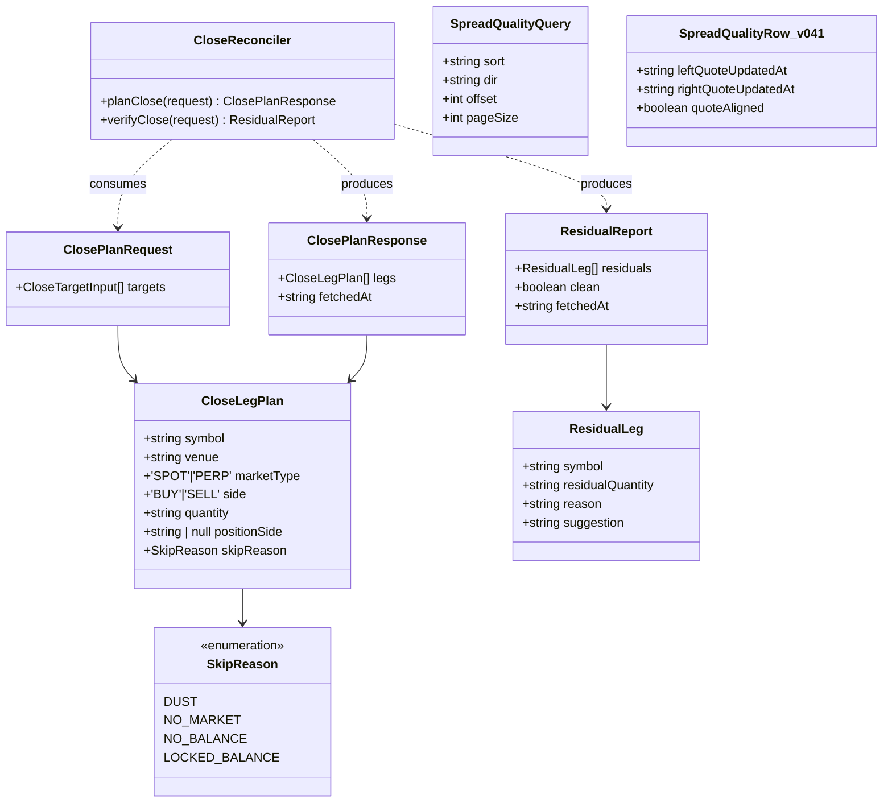
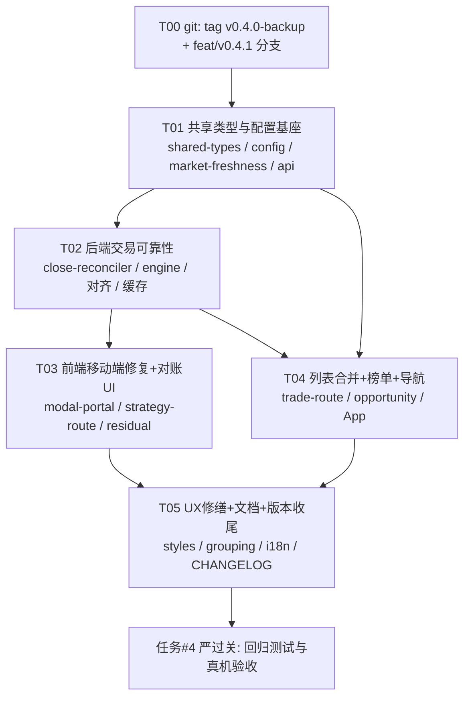

# FlareStar Quant (Gate CrossEx 终端) — v0.4.1 增量架构设计

> 基于 v0.4.0（HEAD `a5b3ab6`）· 对应 `docs/prd-v0.4.1.md`
> 硬约束：止损语义零变更；`feat/v0.4.1` 分支 + `v0.4.0-backup` tag；验收前不 push。
> 本文档为增量设计，仅覆盖 v0.4.1 变更部分；未提及的模块保持现状。

---

# Part A：系统设计

## 1. 实现方案概述与根因分析

### 1.0 总体思路

v0.4.1 是"稳定化 + 移动端可用性"版本。核心策略：

1. **交易可靠性（R2/R3）走"服务端对账规划"**：把"平仓数量该是多少"的裁决权从前端（本地快照）移到后端（交易所实时余额），前端只做确认与展示。复用 v0.4.0 已验证的两条机制：`closePlan` 定时 reduce-only 策略通道、`venue-truth clamp`（`reconcileExitQuantity`）。
2. **R4 走"展示与执行同源"**：引擎侧已有 `freshMarketPair` 双腿 skew 闸门（默认 2000ms），把它提升为共享对齐口径，接入机会榜/价差质量榜/策略页的展示链路，而不是再造一套。
3. **R1/R10 移动端问题按"事件层 + 视口层"修复**，不动业务逻辑与止损判定；R1 的卡死根因按"多因并防"处理并埋点定位。
4. **R5–R9 全部是既有机制的扩展**，零新增依赖包。

技术选型：延续现有栈（Fastify + better-sqlite3 + React 18 + Vite + zod + decimal.js），**不引入任何新框架/库**。React 内置 `createPortal`（react-dom）解决弹窗挂载点问题，无需新依赖。

### 1.1 R1 移动端策略执行卡死 — 根因分析

**提交链路现状**（apps/frontend/src/strategy-route.tsx）：

- 按钮 `start-strategy`（:1989 等 3 处）→ `requestStrategyLaunch()`（:1312）→ `setConfirmingLaunch(true)` → 渲染 `<StrategyLaunchConfirmation>`（:1995/:1577/:2758）→ `onConfirm` → `launchStrategy()`（:1264/:1830/:2561）→ `api.startStrategy(config)`（:1300/:1854/:2587）。
- `launchStrategy` 已有 `if (launching) return` 防重入（:1265），但 `launching` 是 React state，同步双击存在窗口期。

**候选根因（按可能性排序，全部与"点了没反应"的静默失败一致）**：

| # | 根因 | 证据位置 |
|---|------|---------|
| ① | **backdrop 的 `onMouseDown` 抢先关闭弹窗**：`strategy-launch-confirmation.tsx:27` 蒙层 `onMouseDown={() => { if (!busy) onCancel(); }}`。移动端触摸先合成 `mousedown`；若手指落点偏出弹窗一像素、或触摸时页面因地址栏收放发生位移，弹窗在 `click` 到达按钮前已卸载 → 点击静默消失 | strategy-launch-confirmation.tsx:27（spot-debt-dialog.tsx:30 同模式） |
| ② | **fixed 弹窗在 iOS 键盘收放时移出视口**：`.modal-backdrop` 用 `position: fixed; place-items: center`（styles.css:318/1201）；iOS Safari 的 fixed 定位锚在 layout viewport，软键盘收放会瞬间改变视口，弹窗与手指落点错位 → `click` 因 pointer 位移被浏览器取消 | styles.css:318, :1201 |
| ③ | **`useDialogFocus` 自动 focus "Go back" 按钮**：`route-shared.tsx:46-49` 把焦点给 `[data-dialog-autofocus]`（即"返回"按钮，strategy-launch-confirmation.tsx:42），移动端 focus 触发滚动/键盘行为，进一步放大 ①② | route-shared.tsx:34-87 |
| ④ | **按钮 disabled 静默禁用**：`:1989` 的 disabled 依赖 `inputsValid`/`gateCoversEntry`（实时行情 + 保证金估算）；移动端后台 ws 断流时这些值失效，按钮变 disabled 但用户不知道原因 | strategy-route.tsx:1989 |
| ⑤ | 双击缩放/300ms 点击歧义吞 click（index.html viewport 无 `user-scalable` 控制） | apps/frontend/index.html:5 |

**修复方案**（多因并防，全部在前端 UI/事件层，**零业务逻辑变更**）：

1. **弹窗统一改 React Portal**：新增 `ModalPortal` 组件（react-dom `createPortal` 到 `document.body`），三个策略确认弹窗 + position-close-dialog + spot-debt-dialog 全部走它，彻底脱离任何祖先的层叠上下文/滚动容器。
2. **蒙层关闭改用 pointer 事件且带拖动豁免**：`onPointerDown` 记录起点，`onPointerUp` 仅在位移 < 10px 时关闭（防滑动误关）；弹窗内 `touch-action: manipulation`。
3. **提交按钮双保险**：`launching` 同时用 `useRef` 守卫（`launchGuardRef.current`），提交中按钮 `aria-busy` + loading 文案已有，补上提交后失败必须 `setLaunchNotice`（现有 :1304 已覆盖，验收项）。
4. **disabled 原因可见化**：按钮保持禁用但旁边显示具体原因（"行情未就绪/保证金不足/数量未填"），消灭静默禁用。
5. **视口加固**：弹窗容器高度用 `100dvh`，`max-height: calc(100dvh - 32px)` 内部滚动；`viewport` meta 补 `viewport-fit=cover`。
6. **根因埋点**：`launchStrategy` 入口与确认弹窗 confirm 点击各打一条 `console.info`（dev 日志），真机回归时确认根因并记录到 CHANGELOG/回归文档（AC-2）。

止损语义：本需求不触碰任何 `stopLossBps`/止损闸门代码路径；`strategy-route-stoploss.test.tsx` 现有断言守护。

### 1.2 R2 跨所现货-合约对冲平仓完整性 — 根因分析

**v0.4.0（a5b3ab6）已覆盖的**：合约腿 reduce-only 被交易所以数量拒绝后的**被动** venue-truth clamp —— `StrategyActor.venueExitQuantity`/`venueExitQuantitySymbol`（strategy-engine.ts:122-128）、`reconcileExitQuantity()`（:1382-1415）、`exitQuantityFor()`（:1336-1343）、`perpetualLegOf()`（:2578）+ `executeTakerClip` exit 路径按比例缩放对冲腿（:2611-2620）。

**尚未覆盖的三条路径（本需求根因）**：

| # | 未覆盖路径 | 证据位置 |
|---|-----------|---------|
| ① | **平仓数量来自前端本地快照**：position-close-dialog.tsx 的 closePlan targets 用 `target.quantity`（:90-103，来自 portfolio positions 快照）；spot-close.ts 的 `spotCloseSize()` 用 portfolio 余额快照（:46-48）。快照滞后 → 提交数量与交易所实际不符 → 残量 | position-close-dialog.tsx:90-118, spot-close.ts:46-48 |
| ② | **现货腿无 venue-truth clamp**：a5b3ab6 只 clamp `perpetualLegOf` 的永续腿；现货卖出/买回数量从不在提交前对交易所实时余额校验 | strategy-engine.ts:2578-2620 |
| ③ | **`stopStrategy`/`finishQuiesce` 只撤单、不平仓**：策略停止后两条腿留在市场里，用户手动平仓时又走 ①② 的不完整路径 | strategy-engine.ts:753-773, :1856-1898 |

**方案：新增服务端"对账平仓规划 + 完成校验"（ClosePlanReconciler）**

新文件 `apps/backend/src/close-reconciler.ts`，纯服务层（不经由策略引擎），三个入口：

- **`planClose(targets)`**：对每个 target symbol，按 symbol 类型取交易所**实时**真值：
  - 永续腿：复用 `tradingRuntime.reconcilePositionsFromRemote()`（trading-runtime.ts:855-885，已有单飞去重）拿实时持仓 → `abs(quantity)`；
  - 现货腿：实时余额（`reconcileLiveBalances` 通道 / credential vault REST 余额读）→ 多头取 `available`（锁定已占用）、空头负债取 `abs(total)`（与 spot-close.ts 语义一致）；
  - 按 instrument 的 `lotSize` 向下取整、校验 `minSize`/`minNotional`，返回每腿 `{symbol, side, quantity, skipReason?}`；残量 < 最小下单单位 → `skipReason: 'dust'`，**不下单**（PRD Q2：不自动强平）。
- **`verifyClose(targets)`**：closePlan 策略 STOPPED 后（或用户手动触发）再拉一次实时余额/持仓，返回每腿 `residual`（> 最小下单单位的残量清单 + 原因 + 建议），供前端用 `spot-debt-dialog` 模式弹窗（AC-3）。
- 执行通道**不变**：plan 的 targets 喂给现有 `closePlan` 定时 reduce-only 策略（position-close-dialog split 模式同款），`reduceOnly` 保证不会反向开仓，止损路径零触碰。

API（app.ts 新增 2 条路由）：
- `POST /api/close/plan`（写意图闸门，同 `/api/crossex/transfers` 模式）
- `POST /api/close/verify`

**R11（资产分组收敛）**：`position-grouping.ts` 在前端消费 verify 结果——平仓后组内双腿残量均为 0/dust 时分组折叠为"已平仓"态而不是僵尸分组；后端无需改分组逻辑。

### 1.3 R3 资金费率套利一键平仓 — 根因分析

- carry 的"一键平仓"= 用户在持仓/资产页选中 spot 腿 + perp 腿 → position-close-dialog → closePlan reduce-only 策略。数量来源问题与 R2-①/② 完全同源。
- **特有问题（腿失败互锁/状态卡死）**：
  - closePlan 策略中一条腿 reduce-only 数量拒绝：a5b3ab6 已改为"视为状态不匹配、不累加 failureCount、不熔断"，但**被拒腿没有重试用交易所实时数量重算的机制**，会反复以快照数量重试直到用户手动介入；策略可能停在 `STOP_PENDING_REMOTE`/RUNNING 卡死（strategy-engine.ts:1864-1874）。
  - closePlan 全部 slice 发完后若部分腿数量为 0（快照显示有仓、交易所已无仓），计划仍会按 orderCount 空转到 interval 结束。

**方案**（与 R2 同一套 ClosePlanReconciler + 引擎三处小改）：

1. carry 策略行（strategy-route RunningStrategiesPanel）与持仓分组提供"一键平仓"入口 → 前端组装 targets（symbol 列表即可，**不带数量**）→ `POST /api/close/plan` 返回交易所真值数量 → 再提交 closePlan 策略。
2. 引擎侧：closePlan slice 提交前若收到 reduce-only 数量拒绝，对该腿调用一次实时持仓 reconcile（复用 `reconcilePositionsFromRemote` 的去重单飞）重算数量后再重试一次；数量归 0 则该腿标记 `satisfied` 跳过。
3. 收敛保证：closePlan 策略所有 targets 满足（数量归 0/dust）即提前 STOPPED，不空转；任一腿最终失败记 `warning` 日志并进入"待处理"文案（AC-2），策略状态仍收敛为 STOPPED（AC-3）。

### 1.4 R4 价差按获取时间对齐 — 方案

**现状**：引擎侧闸门已存在 —— `freshMarketPair()`（strategy-engine.ts:1146-1160，`marketPairMaxSkewMs` 默认 2000ms :456）基于 `quoteUpdatedAt`（market-hub.ts:1037-1067；shared-types index.ts:941，a5b3ab6 引入）；REST 行按 `fetchedAt` 打戳。**展示链路未对齐**：
- 机会榜/价差质量榜的 spread 计算在 opportunity-service.ts `buildSpread`（:798-812）直接取 bid/ask，不校验两腿 `quoteUpdatedAt`；
- 策略页展示价差 `priceDiffBps`（strategy-route.tsx:983）直接用 `liveMarketFor` 原始价。

**方案**：
1. **阈值配置**：`SPREAD_QUOTE_MAX_SKEW_MS`，默认 2000，环境变量 `GCT_SPREAD_SKEW_MS` 可配（backend config.ts）；前端 `market-freshness.ts` 增加同名常量并从策略页配置接口透传（或直接双端默认 2000，PRD Q1 允许）。
2. **后端展示链路**：opportunity-service `buildSpread` 增加 `quoteAligned` 判定 —— 两腿 `|quoteUpdatedAt 差| ≤ 阈值` 才产出可执行组合；超差组合 `stale: true` 保留但**不参与排序得分与默认过滤**（明确标注"报价未对齐/过期"，AC-1）。`SpreadOpportunity`/`SpreadQualityRow` 增加 `leftQuoteUpdatedAt`/`rightQuoteUpdatedAt`（AC-2 时间戳下发）。
3. **前端策略页**：`priceDiffBps` 改用 `assessMarketPairFreshness` 同源判定（market-freshness.ts 已有），未对齐时显示"—" + 过期标注；展示两腿各自获取时间。**展示与执行同源**：页面判定与引擎 `freshMarketPair` 都读 market-hub 的同一 `quoteUpdatedAt`（AC-3）。
4. spread-quality 候选选择 `selectSpreadQualityCandidates`（spread-quality.ts:515-549）对 `stale` 组合跳过或降权（跟随 opportunity-service 的判定结果，不重复实现）。

### 1.5 R5 服务端缓存与页面性能 — 方案

**已有盘点**（复用，不新建机制）：
- 后端：opportunity-service 30s TTL + filter 级缓存 + 单飞去重（opportunity-service.ts:155/238-330）；spread-quality 5min TTL（spread-quality.ts:78/579-652）；funding-overview SWR 式缓存 + 结算窗口加速（funding-overview.ts:5-80）。
- 前端：opportunity-route `boardCache` 30s（opportunity-route.tsx:52-118），但命中即返回、**无后台再验证**。

**增量**：
1. `POST /api/markets/funding-rankings` 与 `POST /api/markets/funding-history/series`（app.ts:2626/:2655）是剩余的"每请求都打上游"的重端点：包一层与 funding-overview 同型的 TTL+单飞缓存（30s / 60s），参数进 cache key。
2. 前端 SWR：`boardCache` 命中时先回填数据、再后台 `force` 拉新（`load(force=true)` 通道已存在，opportunity-route.tsx:738-757 的 generation 防乱序已就绪）——页面间往返切换即满足 AC-3（不白屏）。
3. App.tsx 页面切换已有 per-route 数据缓存先例（:849 注释"refetch only what is missing or stale"）；把 funding-rankings/series 的前端请求同样接入 stale-first。

### 1.6 R6/R7 持仓/挂单合并列表 — 方案

- 数据源已齐：`TradingSnapshot`（合约持仓/挂单）+ `AuthenticatedPortfolioSnapshot`（现货持仓现货挂单）；`splitOrdersByBusiness`/`prepareSpotHoldingsRows`（execution-split.ts）已产出统一行模型。
- `ExecutionTabKey`（trade-route.tsx:1009-1019）4 个 tab → 收敛为 2 个：`positions`、`orders`；`EXECUTION_TABS` 同步改；老会话 tab key 的 normalize（:1027-1028 注释）扩展映射：`futures-positions|spot-holdings → positions`，`futures-open-orders|spot-open-orders → orders`（Q4：原页签降级为列表内筛选 chips：市场类型「合约/现货」、交易所下拉）。
- 合并行模型放 execution-tables.tsx：新 `UnifiedPositionsTable`/`UnifiedOrdersTable`（列：市场类型标识 + 原两表列并集；窄屏次要列折叠）。撤单/平仓/只减仓操作回调原样接线（AC-3）。
- 资产页（portfolio-route）分组持仓视图不受影响（不动 position-grouping 的分组逻辑，只消费 verify 结果做收敛态，见 R11）。

### 1.7 R8 价差质量榜排行标签 + 分页 — 方案

- **"约 11 条"限制来源**：候选集 cap（spread-quality.ts:549 `candidates.slice(0, cap)`，默认 top-50 重算）+ 前端无分页一屏展示（api.ts:296 `DEFAULT_SPREAD_QUALITY_LIMIT = 50`，但过滤/分组后可见行更少，滚动到底即止，无翻页控件）。
- 后端：`SpreadQualityQuerySchema`（app.ts:2562-2569）加 `sort`（`score|current|mean|volatility|halfLife|depth`，默认 `score`）、`dir`（`asc|desc`）、`offset`、`pageSize`（20/50）；spread-quality `list()` 在缓存 board 全量行上排序 + 切片（缓存 key 仍只含 pairType，排序分页在缓存外切片——与 opportunity-service 的既有注释先例一致，opportunity-service.ts:230-236）。
- 前端：SpreadQualityTable 上方加排序标签 chips（平均价差/当前价差/价差波动 + 保留半衰期/深度），复用 `ExecutionPagination`（execution-pagination-control.tsx，机会榜已用的同一控件）；`api.spreadQuality` options 扩展。

### 1.8 R9 顶部导航精简 — 方案

- 现状：`navItems`（App.tsx:61-67）= Trade / Strategy▾（已有下拉，:1375-1398）/ Funding Rates / Opportunities（直连 funding 板）/ Boros / More▾（Trading Fees，:1410-1430）；Portfolio 无一级入口（经资产卡进入）。
- 方案（Q3 默认分组，6 个一级入口）：**交易 / 策略▾ / 机会▾ / 资金费率 / 资产 / 更多▾**
  - `Opportunities` 由直连改为下拉（复用 `nav-strategy-menu` 模式，4 个 board：funding / funding-top / spread / spread-quality）；
  - `资产(Portfolio)` 升为一级入口；
  - `更多▾` = Boros by Pendle + 交易费用对比。
  - 全部路由可达性由 `frontend-routes.test.ts` 扩展用例守护（frontend-routes.ts 本身零改动——只改导航 UI 层）。
- 移动端适配：topbar 在 ≤640px 断点（styles.css:517 起）压缩为品牌 + 收纳菜单；导航按钮 min-height ≥44px。

### 1.9 R10 移动端 UX 修缮 — 方案

- **触摸目标**：`topbar-navigation-button`、`panel-tabs button`、执行表格操作列在触屏断点 min 44×44px（styles.css 统一 `@media (pointer: coarse)` 或 640px 断点）。
- **图标裁切**：`topbar-nav-glyph`/`nav-boros-mark img` 容器固定尺寸 + `flex-shrink: 0` + `overflow: visible` 排查修复；字体图标降级为纯文本首字。
- **弹窗移动端布局**：`.modal-backdrop`/`.confirm-order-backdrop` 在 ≤640px 改近全屏（`inset: 8px`、内部滚动、关闭按钮 44px），配合 R1 的 Portal 改造一并落地。
- **横向溢出**：页面级 `overflow-x: clip` 排查；表格窄屏包一层 `.table-scroll`（横向滚动 + "左右滑动查看"提示条）。
- 验收方式：任务 #4 真机清单（R12）。

## 2. 文件列表（相对路径 + 改动性质）

### 后端 apps/backend/src/

| 文件 | 性质 | 预计改动点 |
|------|------|-----------|
| `close-reconciler.ts` | **新增** | R2/R3 核心：实时对账平仓规划 + 完成校验（planClose/verifyClose） |
| `close-reconciler.test.ts` | **新增** | 对账规划单测（lot 取整/dust/负债买回/残量判定） |
| `app.ts` | 修改 | 新增 `POST /api/close/plan`、`POST /api/close/verify`（:2515 机会榜路由附近，复用写意图 preHandler 模式）；SpreadQualityQuerySchema 加 sort/dir/offset/pageSize（:2562-2569）；funding-rankings/series 加 TTL 缓存（:2626/:2655） |
| `strategy-engine.ts` | 修改 | R3：closePlan slice 数量拒绝后实时 reconcile 重算重试一次；targets 全满足提前 STOPPED；残量 warning 日志（:1382-1415/:1856-1898/:2611-2620 附近，**不触碰 stopLoss 判定**） |
| `opportunity-service.ts` | 修改 | R4：buildSpread 加双腿 `quoteUpdatedAt` 对齐判定与 `stale` 标记、行带时间戳（:489-812） |
| `spread-quality.ts` | 修改 | R4：候选选择过滤 stale；R8：list() 支持服务端排序 + offset/pageSize 切片（:515-549/:596-606） |
| `market-hub.ts` | 不变 | （quoteUpdatedAt 机制已就绪，仅消费） |
| `funding-rankings-cache.ts` | **新增**（小） | R5：funding-rankings / funding-history series 的 TTL+单飞缓存（与 funding-overview 缓存同型） |
| `config.ts` | 修改 | R4：`GCT_SPREAD_SKEW_MS`（默认 2000） |
| `app.test.ts` / `spread-quality.test.ts` / `opportunity-service.test.ts` / `qa-*.test.ts` | 修改 | 对应新增行为测试；`qa-strategy-route-stoploss` 等止损守护测试断言不变、必须通过 |

### 前端 apps/frontend/src/

| 文件 | 性质 | 预计改动点 |
|------|------|-----------|
| `modal-portal.tsx` | **新增** | R1：`createPortal(document.body)` 弹窗挂载 + pointer 拖动豁免关闭 + dvh 视口加固 |
| `strategy-launch-confirmation.tsx` | 修改 | R1：包 ModalPortal、蒙层改 pointer 事件 |
| `strategy-route.tsx` | 修改 | R1：launching ref 双保险、disabled 原因可见化、根因日志；R4：priceDiffBps 改 freshMarketPair 同源 + 两腿时间展示（:983/:1396）；carry"一键平仓"入口 |
| `spot-debt-dialog.tsx` / `position-close-dialog.tsx` | 修改 | R1：Portal 化；R2：平仓提交前先调 `/api/close/plan` 以服务端数量为准 |
| `close-reconciliation.ts` | **新增** | R2/R3 前端纯函数：调 plan/verify API、残量提示模型（对应 .test.ts 新增） |
| `residual-dialog.tsx` | **新增** | R2/R11：平仓残量对账提示弹窗（spot-debt-dialog 模式） |
| `market-freshness.ts` | 修改 | R4：对齐阈值常量 + 展示用对齐判定（复用 assessMarketPairFreshness，改可配阈值） |
| `opportunity-route.tsx` | 修改 | R5：boardCache 命中后 SWR；R8：spread-quality 排序 chips + ExecutionPagination 接线 |
| `spread-quality-table.tsx` | 修改 | R8：排序标签、stale 标注、分页行窗口 |
| `trade-route.tsx` | 修改 | R6/R7：ExecutionTabKey 收敛为 positions/orders + normalize 兼容（:1009-1028） |
| `execution-tables.tsx` | 修改 | R6/R7：UnifiedPositionsTable/UnifiedOrdersTable + 筛选 chips + 市场类型标识 |
| `execution-split.ts` | 修改 | R6/R7：统一行模型补市场类型字段 |
| `App.tsx` | 修改 | R9：navItems 收敛 6 入口、Opportunities▾ 下拉、Portfolio 一级化（:61-83/:1375-1431） |
| `position-grouping.ts` | 修改 | R11：平仓后分组收敛态（消费 verify 结果） |
| `api.ts` | 修改 | R2/R3/R8：closePlan/closeVerify/spreadQuality 新 options 与 schema |
| `i18n.tsx` | 修改 | 新增文案中英双语 |
| `styles.css` | 修改 | R1/R10：dvh、touch-action、44px 触摸目标、弹窗移动端近全屏、table-scroll、图标裁切 |
| `frontend-routes.ts` | 不变 | R9 只动导航 UI；路由解析与其测试守护全量可达 |

### 共享包

| 文件 | 性质 | 预计改动点 |
|------|------|-----------|
| `packages/shared-types/src/index.ts` | 修改 | 新增 ClosePlanRequest/ClosePlanResponse/CloseLegPlan/ResidualReport schema（:800 附近 SpreadQuality 后）；SpreadQualityQuerySchema 扩展（sort/dir/offset/pageSize）；SpreadQualityRow 加 leftQuoteUpdatedAt/rightQuoteUpdatedAt；机会行结构加 quote 对齐字段（:737-811 区域） |
| `CHANGELOG.md` | 修改 | v0.4.1 条目（含 R1 根因记录） |

### 文档/脚本

| 文件 | 性质 |
|------|------|
| `docs/mobile-regression-checklist-v0.4.1.md` | 新增（R12 真机回归清单，交任务 #4） |

## 3. 数据结构与接口变更



**shared-types 落点（packages/shared-types/src/index.ts）**：
- 新增 zod schema（放在 SpreadQualityResponseSchema 之后，:811 附近）：`CloseTargetInputSchema`、`CloseLegPlanSchema`（含 `SkipReasonSchema = z.enum(['dust','no_market','no_balance','locked_balance'])`）、`ClosePlanResponseSchema`、`ResidualLegSchema`、`ResidualReportSchema`，并导出推断类型。
- `SpreadQualityQuerySchema` 不在 shared-types（现内联于 app.ts:2562）——保持内联但加 sort/dir/offset/pageSize；响应 `SpreadQualityResponseSchema`（:803-810）新增可选 `sort: z.string().optional()`、`offset: z.number().int().nonnegative().optional()`、`total: z.number().int().nonnegative().optional()`（排序后总行数，供分页器显示）。
- `SpreadQualityRowSchema`（:761-800）新增 `leftQuoteUpdatedAt: z.string().optional()`、`rightQuoteUpdatedAt: z.string().optional()`、`quoteAligned: z.boolean().optional()`（optional 保证向后兼容旧缓存行）。
- 机会榜 `OpportunityResponse`（:737）的组合级结构增加同款 quote 时间戳字段（组合展开 detail 内）。
- `LiveMarketSchema`（:912-945）**不改**——`quoteUpdatedAt`/`receivedAt` 已存在。

**REST API 变更**：
| API | 变更 | 说明 |
|-----|------|------|
| `POST /api/close/plan` | 新增 | 请求 `{targets: [{symbol, positionSide?}]}`（symbol 必填、数量不传——服务端实时定）；响应 ClosePlanResponse |
| `POST /api/close/verify` | 新增 | 请求同上；响应 ResidualReport |
| `GET /api/opportunities/spread-quality` | 扩展 | query 加 `sort/dir/offset/pageSize`；响应加 `total` 与行级 quote 时间戳 |
| `GET /api/opportunities` | 扩展 | 组合详情带两腿 quoteUpdatedAt |
| `GET /api/markets/funding-rankings`、`POST /api/markets/funding-history/series` | 行为不变 | 服务端加 TTL 缓存（对调用方透明） |

错误格式沿用现状 `{ error: '<code>' }`（如 `close_plan_unavailable`、`position_reconciliation_rate_limited` 复用 503/429 语义）。

## 4. 程序调用流程

### 4.1 跨所对冲平仓对账流程（R2，含完成校验）

```mermaid
sequenceDiagram
    participant U as 用户(移动端)
    participant FE as PositionCloseDialog
    participant API as app.ts (Fastify)
    participant CR as CloseReconciler
    participant TR as TradingRuntime
    participant EX as 交易所 REST/WS

    U->>FE: 选择平仓目标(双腿) → 确认
    FE->>API: POST /api/close/plan {targets: [GATE_SPOT_X_USDT, KRAKEN_PERP_X_USDT]}
    API->>CR: planClose(targets)
    CR->>TR: reconcilePositionsFromRemote() [单飞去重]
    TR->>EX: 实时持仓查询
    EX-->>TR: 持仓/余额快照
    CR->>CR: 每腿: 现货→实时余额(floor到lotSize) / 合约→实时持仓; 校验 minSize/minNotional; 残量<最小单位→skipReason='dust'
    CR-->>FE: ClosePlanResponse{legs:[{symbol,side,quantity,skipReason?}]}
    FE->>U: 展示每腿实际可平数量(dust 腿标注"碎量不下单")
    U->>FE: 确认执行
    FE->>API: POST /api/strategies (closePlan reduce-only slices, 数量=plan)
    API->>TR: 启动 closePlan 策略(复用现有通道, 止损路径零触碰)
    Note over TR: 引擎逐 slice reduce-only;数量拒绝→venue-truth clamp(a5b3ab6 机制)
    TR-->>FE: 策略 STOPPED (emitStrategyUpdate)
    FE->>API: POST /api/close/verify {targets}
    API->>CR: verifyClose(targets)
    CR->>EX: 再拉实时余额/持仓
    CR-->>FE: ResidualReport{residuals[], clean}
    alt residuals 非空
        FE->>U: ResidualDialog(spot-debt-dialog 模式): 残量+原因+建议(手动补平/调仓)
    else clean
        FE->>U: 提示平仓完成; 资产分组收敛(R11)
    end
```

### 4.2 价差时间对齐流程（R4）

```mermaid
sequenceDiagram
    participant MH as MarketHub(WS)
    participant OS as OpportunityService(30s TTL)
    participant API as app.ts
    participant FE as 机会榜/策略页

    MH->>MH: 双腿报价帧落地, 各自维护 quoteUpdatedAt(各来源最小值)
    OS->>MH: 读双腿 bid/ask + quoteUpdatedAt
    OS->>OS: buildSpread: |leftQuoteUpdatedAt-rightQuoteUpdatedAt| <= SPREAD_QUOTE_MAX_SKEW_MS(默认2s, GCT_SPREAD_SKEW_MS可配)?
    alt 对齐
        OS->>OS: 产出组合(quoteAligned=true, 携带双腿时间戳), 参与排序/得分
    else 未对齐
        OS->>OS: 组合标 stale=true, 不参与默认排序得分, 展示层标注"报价未对齐"
    end
    OS-->>API: 缓存 board(行含 leftQuoteUpdatedAt/rightQuoteUpdatedAt/quoteAligned)
    API-->>FE: GET /api/opportunities[/spread-quality]
    FE->>FE: 展示价差 + 两腿获取时间; stale 行标"过期"
    Note over FE: 策略页 priceDiffBps 改用 assessMarketPairFreshness 同源判定<br/>(与引擎 freshMarketPair 读同一 market-hub quoteUpdatedAt → 展示=执行)
```

### 4.3 carry 一键平仓（R3，失败腿独立处理）

```mermaid
sequenceDiagram
    participant U as 用户
    participant FE as 策略行/持仓组
    participant API as app.ts
    participant CR as CloseReconciler
    participant SE as StrategyEngine(closePlan actor)

    U->>FE: carry 策略行"一键平仓"
    FE->>API: POST /api/close/plan {targets:[现货腿, 永续腿]}
    CR-->>FE: legs(交易所实时数量)
    FE->>API: POST /api/strategies (closePlan, reduce-only)
    SE->>SE: slice 提交
    alt 腿A reduce-only 数量被拒
        SE->>SE: reconcile 实时持仓重算该腿数量(单飞) → 重试一次
        alt 重算后数量=0
            SE->>SE: 该腿标记 satisfied, 跳过
        else 仍失败
            SE->>SE: 记 warning 日志"待处理", 不阻塞腿B
        end
    end
    SE->>SE: 腿B 正常 reduce-only 执行
    SE->>SE: 全部 targets satisfied(含 dust) → 提前 STOPPED, 不空转 interval
    SE-->>U: 策略状态 STOPPED; 失败腿以 warning 呈现待处理(状态必收敛)
```

## 5. Anything UNCLEAR（待明确事项）

1. **R1 根因最终确认**：上表 ①–⑤ 为代码审计得出的候选集，修复按"多因并防"覆盖全部；最终根因以真机复现 + 埋点日志为准，记录进 CHANGELOG 与回归清单（AC-2）。若真机复现发现新根因（如特定 iOS 版本 gesture 事件），在 T03 内追加修复，不改架构。
2. **`GCT_SPREAD_SKEW_MS` 是否需要前端同步可配**：默认双端 2000ms 硬编码 + 后端环境变量；若用户要求 UI 可调再开配置面板（PRD Q1 默认满足）。
3. **现货腿实时余额的账户语义**：CrossEx 统一担保账户下"available"已扣除借币负债；若某些 venue 余额接口需单独区分 funding/margin 账户，以 `reconcileLiveBalances` 现有聚合口径为准（实现时按 venue 逐个验证，必要时在 CloseReconciler 内做 venue 适配）。
4. **spread-quality 分页上限**：候选集仍为 top-50 重算 cap（Q5），排序切换只是在 50 条内重排；"浏览全部候选"受重算成本约束，若用户需要 >50 再议（本版不做）。
5. **止损零变更自查点**：R3 对 closePlan 执行路径的改动（重算重试）位于 reduce-only 出场路径，与 `stopLossBps`/止损闸门无交集；`qa-taker-exit-clamp.test.ts`、`strategy-route-stoploss.test.tsx`、`qa-maker-exit.test.ts` 全量回归必须通过。

---

# Part B：任务分解

## 6. 依赖包

**零新增**。现有依赖足够：

```
- react@18 / react-dom（内置 createPortal，R1 弹窗改造用）
- zod@^4.1.12（shared-types schema 扩展）
- decimal.js@^10.6.0（数量取整，后端已有）
- fastify + better-sqlite3 + ws（后端既有）
- vite + vitest + @playwright/test（构建/测试既有）
```

## 7. 任务列表（按依赖顺序）

> 前置（T00，非编码任务，团队主理人执行一次）：`git tag v0.4.0-backup && git checkout -b feat/v0.4.1`。所有任务在 `feat/v0.4.1` 上进行；**验收前不 push**。
> 守护红线（每个任务通用）：`npm run verify` 通过；`strategy-route-stoploss.test.tsx`、`qa-taker-exit-clamp.test.ts`、`qa-maker-exit.test.ts`、`qa-quote-freshness.test.ts` 断言不得修改。

### T01 共享类型与配置基座（P0，无依赖）

- **目标**：为全部需求铺类型/配置/常量地基。
- **文件**：
  - `packages/shared-types/src/index.ts`（ClosePlan*/Residual* schema + SpreadQualityRow/Response 扩展 + 机会组合 quote 字段）+ `index.test.ts`
  - `apps/backend/src/config.ts`（`GCT_SPREAD_SKEW_MS`，默认 2000）+ `config.test.ts`
  - `apps/frontend/src/market-freshness.ts`（可配对齐阈值常量与展示判定）+ `market-freshness.test.ts`
  - `apps/frontend/src/api.ts`（closePlan/closeVerify/spreadQuality 新 options）
- **验收**：`npm run typecheck` + shared-types 测试通过；旧字段全部 optional、向后兼容。

### T02 后端交易可靠性与对齐（P0，依赖 T01）

- **目标**：R2 + R3 + R4(服务端) + R5(服务端) 一次批量完成。
- **文件**：
  - `apps/backend/src/close-reconciler.ts` + `close-reconciler.test.ts`（**新增**）
  - `apps/backend/src/app.ts`（close/plan、close/verify 路由；SpreadQualityQuery 扩展；funding-rankings/series TTL 缓存）
  - `apps/backend/src/strategy-engine.ts`（closePlan 数量拒绝重算重试、satisfied 提前 STOPPED、残量 warning）+ 相关 `qa-*.test.ts` 扩展
  - `apps/backend/src/opportunity-service.ts` + `opportunity-service.test.ts`（quote 对齐 + stale 标记 + 时间戳下发）
  - `apps/backend/src/spread-quality.ts` + `spread-quality.test.ts`（stale 过滤 + 服务端排序/分页切片）
  - `apps/backend/src/funding-rankings-cache.ts` + 测试（**新增**）
- **验收**：
  - 模拟交易所余额与快照不一致时，plan 返回交易所真值；dust 腿 skipReason='dust' 不下单；
  - closePlan 一腿失败不阻塞另一腿、状态收敛 STOPPED；
  - spread-quality sort/dir/offset/pageSize 服务端生效且命中缓存不重算；
  - **止损守护测试全绿**；总测试套件通过。

### T03 前端移动端修复与对账平仓 UI（P0，依赖 T01、T02）

- **目标**：R1 + R4(前端) + R2/R3 前端闭环。
- **文件**：
  - `apps/frontend/src/modal-portal.tsx` + 测试（**新增**）
  - `apps/frontend/src/strategy-launch-confirmation.tsx`、`strategy-route.tsx`（Portal 化、pointer 蒙层、launching ref、disabled 原因、根因日志、priceDiff 同源对齐 + 时间展示、carry 一键平仓入口）
  - `apps/frontend/src/close-reconciliation.ts` + 测试、`residual-dialog.tsx` + 测试（**新增**）
  - `apps/frontend/src/position-close-dialog.tsx`、`spot-debt-dialog.tsx`（Portal 化 + plan 前置）
- **验收**：
  - 确认弹窗挂 document.body；蒙层拖动不误关；提交中 loading + 双击不重复下单（单测模拟连点）；
  - priceDiff 未对齐显示"—"并标注过期；对齐时显示两腿时间；
  - 平仓弹窗先 plan 后执行；残量弹窗在 verify 非空时出现；
  - `strategy-route-stoploss.test.tsx` 全绿。

### T04 列表合并、榜单分页与导航精简（P1，依赖 T01、T02）

- **目标**：R6 + R7 + R8 + R9。
- **文件**：
  - `apps/frontend/src/trade-route.tsx`、`execution-tables.tsx`、`execution-split.ts`（合并列表 + 筛选 chips + normalize 兼容）+ 对应 `.test.*`
  - `apps/frontend/src/opportunity-route.tsx`、`spread-quality-table.tsx`（排序 chips + ExecutionPagination + SWR）+ `spread-quality-table.test.tsx`、`qa-opportunity-board-cache.test.ts` 扩展
  - `apps/frontend/src/App.tsx`（navItems 收敛 + Opportunities▾ + Portfolio 一级）+ `frontend-routes.test.ts` 扩展（全路由可达断言）
- **验收**：
  - 持仓/挂单各一个统一列表，合约+现货同表可筛可操作；老 tab key 恢复会话不崩；
  - 价差质量榜排序切换走服务端参数、分页 20/50 可翻全量；
  - 导航 ≤6 入口且 `frontend-routes.test.ts` 全路由可达通过；关键路径（开策略/看持仓/一键平仓）点击层级不增加。

### T05 移动端 UX 修缮、文档与版本收尾（P1，依赖 T03、T04）

- **目标**：R10 + R11 + R12 + 交付收尾。
- **文件**：
  - `apps/frontend/src/styles.css`（dvh、touch-action、44px 触摸目标、弹窗近全屏、table-scroll、图标裁切）
  - `apps/frontend/src/position-grouping.ts` + 测试（平仓分组收敛态）
  - `apps/frontend/src/i18n.tsx`（全部新文案中英）
  - `docs/mobile-regression-checklist-v0.4.1.md`（**新增**，R12，含 R1 根因记录位）
  - `CHANGELOG.md`、`npm run version:sync`（全工作区 0.4.1）
- **验收**：
  - 触摸目标 ≥44×44px、弹窗移动端可滚动可关闭、横向无页面级滚动（回归清单逐项勾选）；
  - 平仓后资产分组收敛、无僵尸分组；
  - `npm run verify` 全绿；CHANGELOG/version 一致性测试通过。

## 8. 共享知识（跨文件约定）

- **Symbol 命名**：`VENUE_MARKET_BASE_QUOTE`（如 `GATE_SPOT_BTC_USDT`、`KRAKEN_PERP_X_USDT`）；venue `SPOT` 一律归一化为 `GATE`（spot-close.ts 先例）。
- **新鲜度时间戳唯一口径**：一律使用 `quoteUpdatedAt`（market-hub 维护、各来源最小值），**禁止**回退 `updatedAt`；REST 批量行用 `fetchedAt`。
- **对齐阈值**：`SPREAD_QUOTE_MAX_SKEW_MS` 默认 2000ms；后端 `config.ts` 环境变量 `GCT_SPREAD_SKEW_MS`，前端 `market-freshness.ts` 常量同值。
- **API 错误格式**：`{ error: '<snake_case_code>' }`；可重试拥堵用 429 + `*_rate_limited`，上游不可用 503 + `*_unavailable`（沿用现有约定）。
- **平仓语义**：所有平仓单必须 `reduceOnly`；数量一律由服务端实时对账产出，前端不再自行从快照推数量（close/plan 请求不传数量）；< 最小下单单位 → dust，不自动强平。
- **向后兼容**：shared-types 新字段全部 `optional`；ExecutionTabKey 旧值 normalize 到合并 tab；前端 boardCache 命中必须后台再验证。
- **i18n**：所有新 UI 文案必须走 `t()` 且中英双份（i18n.tsx）。
- **止损红线**：不修改 `stopLossBps` 判定、止损闸门与止损日志语义；触碰相邻代码时以 `qa-taker-exit-clamp` / `qa-maker-exit` / `qa-quote-freshness` / `strategy-route-stoploss` 测试守护，断言不得修改。
- **缓存约定**：服务端重计算缓存 TTL——机会榜 30s、spread-quality 5min、funding-rankings/series 30–60s；`refresh=1` 绕过（手动刷新语义不变）；失败结果永不缓存。

## 9. 任务依赖图


